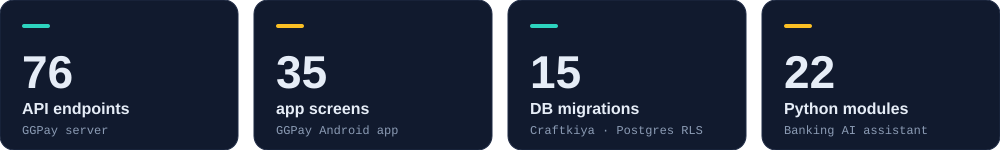
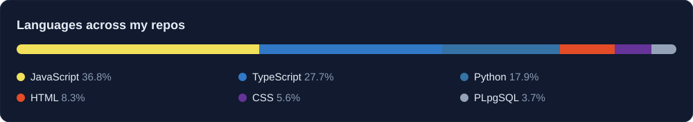

<!-- banner and cards: generated by scripts/cards.js, refreshed weekly by .github/workflows/cards.yml -->
<picture>
  <source media="(prefers-color-scheme: dark)" srcset="assets/banner-dark.svg?v=2">
  <source media="(prefers-color-scheme: light)" srcset="assets/banner-light.svg?v=2">
  
</picture>

## About

I'm an **AI Engineer** and **Full-Stack Developer**. I train and fine-tune machine-learning models, build LLM features like RAG pipelines, chat assistants and agents, and then ship them inside real products: Android apps, web stores and admin dashboards.

What I bring to a project:

- **Models:** data preparation, training, fine-tuning and evaluation with PyTorch, TensorFlow, scikit-learn and Hugging Face
- **LLM apps:** RAG over documents with vector search, multi-turn chat assistants, tool-calling agents with LangGraph and MCP
- **Product:** the API, database, web and mobile app around the model, deployed and working end to end

## Featured projects

| Project | What it does | Built with |
|---|---|---|
| [**Banking AI Assistant**](https://github.com/akshayreddy9/Chat-Bot-for-Dynamic-Banking-Interaction) | Conversational AI for banking: intent recognition, multi-turn dialogue state, context switching and tool-backed workflows for loans, cards and account queries, with Gemini responses and a rule-based fallback | Python · Flask · Gemini · NLP |
| [**Road Text Recognition**](https://github.com/akshayreddy9/Automated-Text-Extraction-and-Recognition-from-Road-Videos-and-Images) | Team project: deep-learning OCR (CRAFT text detection + recognition model) that reads signs and text from road videos and images | Python · PyTorch · EasyOCR · React · Express |
| [**GGPay**](https://github.com/akshayreddy9/ggpay) | UPI payments app for Android with a live admin panel: send money, QR scan, bills, rewards, chat and history, synced in real time over WebSockets. Deployed online with an installable APK | React Native · Expo · Node.js · Socket.io · MongoDB |
| [**Craftkiya**](https://github.com/akshayreddy9/craftkiya) | E-commerce store for handmade string-art portraits: photo configurator, Razorpay checkout with verified webhooks, order tracking and an admin studio, secured by Postgres row-level security | Next.js 16 · TypeScript · Supabase · Tailwind |

## Numbers

<picture>
  <source media="(prefers-color-scheme: dark)" srcset="assets/numbers-dark.svg">
  <source media="(prefers-color-scheme: light)" srcset="assets/numbers-light.svg">
  
</picture>

<picture>
  <source media="(prefers-color-scheme: dark)" srcset="assets/languages-dark.svg">
  <source media="(prefers-color-scheme: light)" srcset="assets/languages-light.svg">
  
</picture>

## Stack

**AI / ML**

**LLMs & agents:** Hugging Face Transformers · LoRA / PEFT fine-tuning · LangChain · LangGraph · MCP · RAG · FAISS · ChromaDB · Gemini · OpenAI · Claude 
**ML practice:** data pipelines · feature engineering · XGBoost · model evaluation · prompt engineering · model serving with FastAPI

**Full-stack & cloud**

**Also:** React Native · Expo · Socket.io · Render · Expo EAS

## Work with me

I take on freelance work: AI features (chatbots, RAG over your documents, custom models), full-stack web apps and Android apps. Email me at **[akshaykalluri9848@gmail.com](mailto:akshaykalluri9848@gmail.com)** with your idea.
